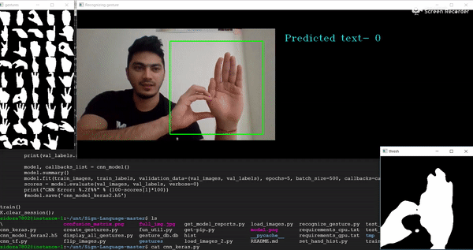
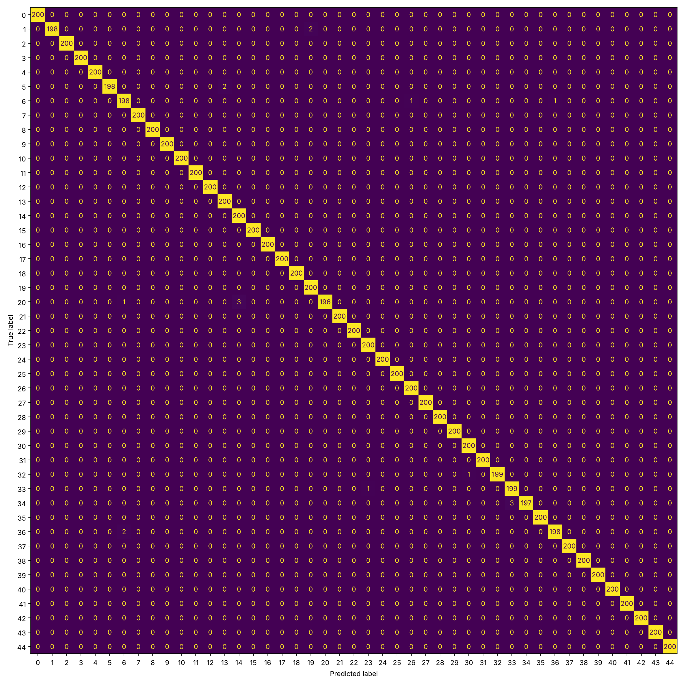

# Sign Language Recognition System

A real-time Sign Language recognition system. It reads a live webcam feed, isolates the hand, and uses a Convolutional Neural Network (CNN) to predict the sign being shown.

Built as a college project at NIT Hamirpur.

## Motivation

Many deaf and hard-of-hearing people depend on interpreters for everyday communication. This project explores how a low-cost, webcam-based system can recognize signs and display them as text.

## How it works

1. **Hand segmentation:** a hand histogram (`set_hand_histogram.py`) is used to separate the hand from the background.
2. **Dataset creation:** `create_gestures.py` captures labelled gesture images from the webcam.
3. **Augmentation:** `Rotate_images.py` flips the images to add variety.
4. **Dataset split:** `load_images.py` splits the images into training, validation and test sets (about 5/6, 1/12, 1/12). Each original image and its mirrored copy are kept in the same split, so the model is never tested on a flipped version of an image it trained on.
5. **Training:** `cnn_model_train.py` trains a CNN (Conv2D + MaxPooling layers, dense layer, dropout, softmax) with Keras.
6. **Live recognition:** `final.py` runs the webcam loop and shows the predicted sign.

## Tech stack

- Python
- TensorFlow / Keras
- OpenCV
- NumPy

## Project structure

```
.
├── Code/
│   ├── set_hand_histogram.py
│   ├── create_gestures.py
│   ├── Rotate_images.py
│   ├── load_images.py
│   ├── display_gestures.py
│   ├── cnn_model_train.py
│   ├── evaluate.py
│   ├── final.py
│   └── gesture_db.db
├── img/            # demo images and screenshots
│   └── results/    # confusion matrix written by evaluate.py
├── LICENSE
├── README.md
└── requirements.txt
```

## Setup

```bash
git clone https://github.com/Atul-Koundal/sign-language-recognition.git
cd sign-language-recognition
python3 -m venv venv
source venv/bin/activate
pip install -r requirements.txt
```

The pinned versions in `requirements.txt` are the ones this project was updated and tested against (TensorFlow 2.21 / Keras 3). On Linux, `pyttsx3` also needs a speech engine such as `espeak-ng` plus `aplay` (Fedora: `sudo dnf install espeak-ng alsa-utils`; Ubuntu: `sudo apt install espeak-ng alsa-utils`). See [RUN.md](RUN.md) for the full step-by-step guide.

## Getting the data and a model

The gesture images and the trained model are **not stored in this repository** (they are large and listed in `.gitignore`), so `train`, `evaluate` and `final.py` will not run on a fresh clone until you have them. You have two options:

1. **Use the original dataset.** Download the EvilPort2/Sign-Language 1.0 release from [Zenodo](https://zenodo.org/records/1244279) and extract the gesture images so they sit at `Code/gestures/<class_id>/<n>.jpg` (one folder per class, numbered images 1-1200 in each).
2. **Record your own.** Run `create_gestures.py` for each sign. `gesture_db.db` maps each class id to its label.

Then run `Rotate_images.py`, `load_images.py` and `cnn_model_train.py` (see Usage). Training writes `cnn_model_keras2.keras`, which `evaluate.py` and `final.py` load. If you already have a trained `cnn_model_keras2.keras`, put it in `Code/` and `final.py` will run without the images, because the input size is read from the model itself.

## Usage

Run these from inside the `Code/` folder:

```bash
python set_hand_histogram.py   # calibrate the hand histogram for your hand and lighting (required)
python create_gestures.py      # capture and label gesture images
python Rotate_images.py        # augment the images
python load_images.py          # split into train / validation / test sets
python display_gestures.py     # (optional) view the captured gestures
python cnn_model_train.py      # train the model -> cnn_model_keras2.keras
python evaluate.py             # test-set accuracy, per-class report, confusion matrix
python final.py                # start live recognition
```

Keys in `final.py`: `q` quit, `v` toggle voice, `t` switch to calculator mode, `c` switch back to text mode.

## Demo



## Results

The original authors report over 95% accuracy on 44 ASL characters. My first training run on the EvilPort2 dataset reached 99.96% validation accuracy (99.98% on the test set), but that run used a random split in which an image could be in the test set while its mirrored copy was in training, so it overstated how well the model generalizes. The split is now done per original image. All images still come from one signer, so the numbers say little about new signers, backgrounds or lighting. 

### Test-set evaluation

`evaluate.py` loads `cnn_model_keras2.keras`, scores it on the held-out test split, prints test accuracy and a per-class precision/recall report, and saves the confusion matrix:



`Rotate_images.py` adds a mirrored copy of every image. `load_images.py` splits by original image (seed 42, per class) and checks that no original/mirror pair crosses splits. Even so, all images come from one signer in one setting, so treat the test accuracy as an upper bound for a new signer or background.

## My changes

- [x] Update the code for current TensorFlow / Keras versions
- [ ] Record my own gesture dataset
- [x] Add evaluation (test accuracy, confusion matrix): `Code/evaluate.py`
- [ ] Add new features or improvements

## Limitations

- Accuracy depends on lighting, background and camera quality.
- It recognizes static signs only, not full continuous sign language.
- It covers a limited vocabulary.
- The split is per original image, but not per signer: all images come from one person, so generalization to other signers is untested.

## License

MIT. See [LICENSE](LICENSE).

Gesture images and labels come from the original author's release:
EvilPort2/Sign-Language 1.0, https://zenodo.org/records/1244279
